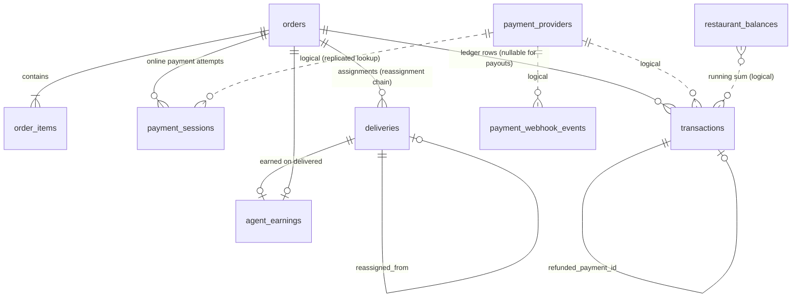

# Database Design — `order_service` (per country shard)

Every country (`region`) has its own PostgreSQL cluster with a database named **`order_service_<region>`**, plus a cold archive cluster **`order_service_archive_<region>`** (Phase 5). All of them run the **same migrations** and therefore have the identical schema described here. See [system-design.md §3](./system-design.md#3-sharding-by-country) for routing.

This document supersedes the ERD draft in `img_2.png`. Changes vs the draft are listed in §7.

---

## 1. Conventions (inherited from core-service migrations)

| Topic | Rule | Example |
|-------|------|---------|
| Migration style | Knex migration files containing **raw SQL** via `knex.raw(\`...\`)`, with a real `down()` | `20260418000020_create_orders_table.ts` |
| Migration naming | `<timestamp>_create_<table>_table.ts` (`alter_`, `seed_` likewise) | `20260418000010_create_payment_providers_table.ts` |
| Table names | snake_case, **plural** | `orders`, `order_items` |
| Column names | snake_case; FKs `<singular>_id`; timestamps `<verb>_at`; booleans `is_<adj>` | `branch_id`, `picked_at`, `is_online` |
| Primary keys | `id BIGSERIAL PRIMARY KEY`; composite PK for pure state tables; `INT` PK for the seeded lookup | `PRIMARY KEY (restaurant_id, currency)` |
| Shard column | every sharded table has `region TEXT NOT NULL` immediately after `id` | |
| Foreign keys | `CONSTRAINT fk_<table>_<column> FOREIGN KEY (...) REFERENCES <table>(id)` — in-shard only, **always with a supporting index** | `fk_order_items_order_id` |
| Unique | `CONSTRAINT uq_<table>_<col>[_<col>] UNIQUE (...)` | `uq_orders_public_id` |
| Check / enum-like | inline `TEXT NOT NULL CHECK (col IN (...))` (core style); no native PG enums | `status TEXT NOT NULL CHECK (status IN (...))` |
| Index | `CREATE INDEX idx_<table>_<col>[_<col>] ...`; GIST: `idx_<table>_<col>_gist`; each with a `-- supports …` comment | `idx_orders_branch_status_created_at` |
| Timestamps | `created_at`, `updated_at` `TIMESTAMP NOT NULL DEFAULT NOW()` (UTC, core style); transition timestamps `TIMESTAMP NULL` until they happen | `accepted_at TIMESTAMP NULL` |
| Money | `INT NOT NULL` minor units + `currency TEXT CHECK (currency IN ('EGP','SAR'))` on the row or its parent | `subtotal INT NOT NULL` |
| Coordinates | `DECIMAL(10,7)` (same as core `customer_addresses`), PostGIS `GEOGRAPHY` generated column where we search by distance | |

**Deliberate choices** (documented so nobody "fixes" them back):

1. Money is **`INT` minor units**, never `DECIMAL`/float: integer math is exact, Knex returns `DECIMAL` as strings (easy to mishandle), and aggregation is faster. `INT` holds up to ~21 million EGP per row, enough for any single order, payout or balance today.
2. **No foreign keys to core-service data.** `customer_id`, `customer_address_id`, `restaurant_id`, `branch_id`, `product_id`, `agent_id`, `src_acc_id`, `dst_acc_id` are **logical references** (another database). Integrity is enforced by validating through the core-client at write time and by snapshotting what we display (§1.1).
3. FKs **only within the shard**, each with an index (Postgres does not auto-index FK columns).
4. **Every index exists because of a named query** (§5). No speculative indexes; a `UNIQUE` constraint already provides its index, so we never add a second index on the same column.
5. Order and payment data is **append-mostly**: status transitions, not deletes. No soft delete in this schema.

Required extensions (first migration that needs them): `pg_partman` (Phase 1, partitioning — §4.0), `postgis` (Phase 4, agent proximity search).

### 1.1 Cross-service references (logical, no DB FK)

| Logical reference | Where in this service | Source of truth |
|---|---|---|
| `users.id` | `orders.customer_id`, `orders.delivery_agent_id`, `transactions.src_acc_id / dst_acc_id`, `agent_earnings.agent_id`, `idempotency_keys.user_id` | core `users` |
| `customer_addresses.id` | `orders.customer_address_id` | core `customer_addresses` |
| `restaurants.id` | `orders.restaurant_id`, `restaurant_balances.restaurant_id` | core `restaurants` |
| `restaurant_branches.id` | `orders.branch_id` | core `restaurant_branches` |
| `products.id` | `order_items.product_id` | core `products` |

Snapshots taken at order time so history survives edits/deletes in core: `order_items.name_snapshot`, `unit_price_snapshot`, `image_url_snapshot`, `orders.delivery_lat / delivery_lng / delivery_address_text_snapshot`, `deliveries.pickup_* / dropoff_*`.

---

## 2. Money & accounts model

- Amount columns: `INT`, minor units, **always positive** on ledger rows. Direction is expressed by `src_acc_id` / `dst_acc_id` and `transaction_type`, never by sign.
- `currency` is `'EGP' | 'SAR'`, equal to the branch currency from core. Balances are keyed by `(restaurant_id, currency)` so a multi-currency restaurant never needs a migration.
- **Accounts** in the ledger are core user ids:
  - customer ⇒ customer user id
  - restaurant ⇒ **restaurant owner user id** (`restaurants.owner_id` in core, read from the cached restaurant before the transaction opens)
  - delivery agent ⇒ agent user id (earnings live in `agent_earnings`)
  - **QuickBite platform ⇒ `NULL`**

**Money-flow matrix** (balance effect applies to `restaurant_balances`):

| `transaction_type` | When | `method` | `src_acc_id` | `dst_acc_id` | Status lifecycle | Restaurant balance effect |
|---|---|---|---|---|---|---|
| `charge` | Kashier capture webhook | `online` | customer | NULL (platform holds funds) | `succeeded` / `failed` (audit) | — (credited at delivery) |
| `cod_collection` | inserted at COD placement | `cod` | customer | restaurant owner | `pending` → `succeeded` on delivered / `failed` on cancel | — (credited at delivery) |
| `commission` | delivered | `system` | restaurant owner | NULL | `succeeded` | settlement credits `subtotal − commission` |
| `refund` | admin refund; auto on reject/cancel of a paid online order | `online` / `cod` | NULL | customer | `pending` → `succeeded` (webhook) | − restaurant share **only if already settled**, capped at balance |
| `payout` | admin records a bank transfer | `bank_transfer` | NULL | restaurant owner | `succeeded` | − amount (must be ≤ balance) |
| `adjustment` | COD void audit (amount 0 allowed), refund remainder beyond balance | `system` | any / NULL | any / NULL | `succeeded` | as described in `note` |

---

## 3. ERD



Standalone: `idempotency_keys`. There is **no** outbox, inbox or status-history table (see §7).

---

## 4. Tables

### 4.0 Partitioning (`pg_partman`)

`orders` and `order_items` are **range-partitioned by month** and managed by `pg_partman` 5.x (schema `partman`). ~146 GB/yr of orders (system-design §11) is ~12 GB/month: monthly partitions keep each partition's indexes small, let range queries skip whole months, and let Phase 5 drop a month that the archiver has emptied (`DROP TABLE` returns the disk at once; a `DELETE` leaves dead rows for VACUUM). Rows cross clusters in batches — partitions can't move between clusters (archival.md D1).

| Table | Partition key | Interval | Premake | Default partition |
|---|---|---|---|---|
| `orders` | `created_at` | 1 month | 4 | yes (`orders_default`) |
| `order_items` | `order_created_at` (copy of the parent's `created_at`) | 1 month | 4 | yes |

Rules that follow from Postgres partitioning:

1. **PK / UNIQUE must contain the partition key** → `orders` PK is `(id, created_at)`, `uq_orders_public_id` is `(public_id, created_at)`.
2. **`public_id` is a UUIDv7 and `created_at` is derived from it** on insert (`uuid_extract_timestamp(public_id) AT TIME ZONE 'UTC'`). So `(public_id, created_at)` unique ⇔ `public_id` unique, and a lookup by `public_id` also knows `created_at` → it prunes to **one** partition (Q-O1).
3. **Every FK to `orders` is composite**: the child carries `order_created_at` and references `orders (id, created_at)`. This applies to every later table with an `order_id` (`payment_sessions`, `transactions`, `deliveries`, `agent_earnings`); their DDL below still shows the single-column FK and is updated by the phase that creates them.
4. Every query on these tables carries a `created_at` / `order_created_at` predicate (exact for single rows, a range for lists) so the planner prunes partitions.
5. `idempotency_keys` is **not** partitioned: its PK on `key_hash` alone is what makes two concurrent requests with the same key collide; a partitioned PK would have to include `created_at` and lose that.

Operations:

- Installed **SQL-only** (the upstream `make NO_BGW=1` build): on Windows, `pg_partman.control` + `pg_partman--5.5.0.sql` are copied into `share/extension`. Without the background worker, `src/lib/jobs/partition-maintenance.ts` runs `CALL partman.run_maintenance_proc()` on every hot shard at boot and every `PARTMAN_MAINTENANCE_INTERVAL_MIN` (default 60; `0` disables it where `pg_partman_bgw` or `pg_cron` runs maintenance). The procedure holds an advisory lock, so several instances are safe.
- `infinite_time_partitions = true`: partitions are premade even on a quiet shard.
- Rows in a `*_default` partition mean maintenance stopped running: alert on `SELECT count(*) FROM orders_default`, then `CALL partman.partition_data_proc('public.orders')`.
- No pg_partman retention: the archiver empties prior-year months and drops their partitions (Phase 5). On the archive clusters, past months are created on demand with `partman.create_partition_time` and maintenance does not run.
- Every connection runs with `TIME ZONE 'UTC'` and parses `TIMESTAMP` as UTC (`lib/knex/knexfile.ts`), so partition bounds, `NOW()` and the API agree. Timestamp parameters are sent as UTC ISO strings (`toUtcTimestamp`), because Postgres ignores the offset of a value bound to a `TIMESTAMP` column.

### 4.1 `orders`

Order header and the primary write target. Everything a list screen needs is on this row, so lists never join.

```sql
CREATE TABLE orders (
    id BIGSERIAL NOT NULL,
    region TEXT NOT NULL,                                  -- shard key (country)
    public_id UUID NOT NULL,                               -- client-facing id, UUIDv7
    country_code TEXT NOT NULL,
    restaurant_id BIGINT NOT NULL,                         -- core restaurants.id (logical)
    branch_id BIGINT NOT NULL,                             -- core restaurant_branches.id (logical)
    customer_id BIGINT NOT NULL,                           -- core users.id (logical)
    customer_address_id BIGINT NOT NULL,                   -- core customer_addresses.id (logical)

    -- delivery snapshot (survives the customer editing/deleting the address)
    delivery_lat DECIMAL(10,7) NOT NULL,
    delivery_lng DECIMAL(10,7) NOT NULL,
    delivery_address_text_snapshot TEXT NOT NULL,

    status TEXT NOT NULL CHECK (status IN (
        'pending_payment','placed','accepted','rejected',
        'preparing','ready','assigned','picked','delivered','cancelled')),
    cancel_reason TEXT NULL,                               -- required for rejected / cancelled

    -- money (minor units)
    subtotal INT NOT NULL,
    delivery_fee INT NOT NULL,
    service_fee INT NOT NULL,
    total INT NOT NULL,                                    -- subtotal + delivery_fee + service_fee
    commission INT NOT NULL DEFAULT 0,                     -- platform cut, computed at delivery
    currency TEXT NOT NULL CHECK (currency IN ('EGP','SAR')),
    payment_method TEXT NOT NULL CHECK (payment_method IN ('online','cod')),

    delivery_agent_id BIGINT NULL,                         -- current agent (denormalized from deliveries)

    created_at TIMESTAMP NOT NULL,                         -- = timestamp inside public_id (partition key)
    updated_at TIMESTAMP NOT NULL DEFAULT NOW(),
    accepted_at TIMESTAMP NULL,
    rejected_at TIMESTAMP NULL,
    ready_at TIMESTAMP NULL,
    assigned_at TIMESTAMP NULL,
    picked_at TIMESTAMP NULL,
    delivered_at TIMESTAMP NULL,
    cancelled_at TIMESTAMP NULL,

    CONSTRAINT pk_orders PRIMARY KEY (id, created_at),
    CONSTRAINT uq_orders_public_id UNIQUE (public_id, created_at),
    CONSTRAINT chk_orders_total CHECK (total = subtotal + delivery_fee + service_fee),
    CONSTRAINT chk_orders_commission CHECK (commission >= 0 AND commission <= subtotal)
) PARTITION BY RANGE (created_at);

-- supports GET /customer/orders?year=                              (Q-O2)
CREATE INDEX idx_orders_customer_id_created_at ON orders (customer_id, created_at DESC);
-- supports GET /restaurant/orders?branchId=&status=&from=&to=       (Q-O3, most queried)
CREATE INDEX idx_orders_branch_status_created_at ON orders (branch_id, status, created_at DESC);
-- supports the payment-expiry sweep and the assignment scan          (Q-O4, Q-O5)
CREATE INDEX idx_orders_status_created_at ON orders (status, created_at)
    WHERE status IN ('pending_payment','ready','assigned');
-- supports the agent's current orders                               (Q-O6)
CREATE INDEX idx_orders_delivery_agent_id_status ON orders (delivery_agent_id, status)
    WHERE delivery_agent_id IS NOT NULL;
-- supports GET /admin/orders without a branchId                      (Q-O9)
CREATE INDEX idx_orders_created_at ON orders (created_at DESC);

SELECT partman.create_parent(p_parent_table := 'public.orders', p_control := 'created_at',
                             p_interval := '1 month', p_premake := 4);
```

Notes:
- `public_id` lookups (Q-O1) use the index behind `uq_orders_public_id`, with `created_at` derived from the id: one partition, no extra index.
- `total` is denormalized for reads and asserted by `chk_orders_total`.
- Payment state is derived from the ledger (latest `charge` / `cod_collection`), not stored on the order.

### 4.2 `order_items`

```sql
CREATE TABLE order_items (
    id BIGSERIAL NOT NULL,
    region TEXT NOT NULL,
    order_id BIGINT NOT NULL,
    order_created_at TIMESTAMP NOT NULL,                   -- parent's created_at (partition key + FK)
    product_id BIGINT NOT NULL,                            -- core products.id (logical)
    quantity INT NOT NULL CHECK (quantity > 0),
    unit_price_snapshot INT NOT NULL,                      -- minor units, frozen at order time
    name_snapshot TEXT NOT NULL,
    image_url_snapshot TEXT NULL,
    line_total INT NOT NULL,                               -- quantity * unit_price_snapshot
    created_at TIMESTAMP NOT NULL DEFAULT NOW(),

    CONSTRAINT pk_order_items PRIMARY KEY (id, order_created_at),
    CONSTRAINT fk_order_items_order_id FOREIGN KEY (order_id, order_created_at)
        REFERENCES orders (id, created_at) ON DELETE CASCADE,
    CONSTRAINT chk_order_items_line_total CHECK (line_total = quantity * unit_price_snapshot)
) PARTITION BY RANGE (order_created_at);

-- supports order detail + list expansion with one whereIn, and the FK   (Q-O7)
CREATE INDEX idx_order_items_order_id_order_created_at ON order_items (order_id, order_created_at);

SELECT partman.create_parent(p_parent_table := 'public.order_items', p_control := 'order_created_at',
                             p_interval := '1 month', p_premake := 4);
```

No `product_id` index: this service never queries items by product (analytics will).

### 4.3 `payment_providers` (lookup — replicated, same rows on every shard)

```sql
CREATE TABLE payment_providers (
    id INT PRIMARY KEY,
    name TEXT NOT NULL,
    is_enabled BOOLEAN NOT NULL DEFAULT TRUE,
    priority SMALLINT NOT NULL DEFAULT 100,

    CONSTRAINT uq_payment_providers_name UNIQUE (name)
);

INSERT INTO payment_providers (id, name, is_enabled, priority) VALUES
    (1, 'kashier', TRUE, 10),
    (2, 'cod',     TRUE, 20)
ON CONFLICT (id) DO NOTHING;
```

Fixed ids so every shard agrees. Read once per process and cached in memory (like core's `PermissionCacheService`). `is_enabled` lets ops disable a provider without a deploy; `priority` is reserved for multi-provider routing.

### 4.4 `payment_sessions` (Kashier session lifecycle)

```sql
CREATE TABLE payment_sessions (
    id BIGSERIAL PRIMARY KEY,
    region TEXT NOT NULL,
    order_id BIGINT NOT NULL,
    provider_id INT NOT NULL,                              -- payment_providers.id (logical; providers are replicated)
    provider_session_id TEXT NOT NULL,                     -- Kashier session id
    redirect_url TEXT NOT NULL,
    amount INT NOT NULL CHECK (amount > 0),
    currency TEXT NOT NULL CHECK (currency IN ('EGP','SAR')),
    status TEXT NOT NULL CHECK (status IN (
        'initialized','pending','authorized','captured','failed','expired','cancelled')),
    expires_at TIMESTAMP NOT NULL,
    raw_init_payload JSONB NOT NULL,                       -- what we sent to Kashier (no secrets)
    raw_last_payload JSONB NULL,                           -- last update from Kashier
    created_at TIMESTAMP NOT NULL DEFAULT NOW(),
    updated_at TIMESTAMP NOT NULL DEFAULT NOW(),

    CONSTRAINT fk_payment_sessions_order_id FOREIGN KEY (order_id) REFERENCES orders(id),
    CONSTRAINT uq_payment_sessions_provider_session_id UNIQUE (provider_session_id)
);

-- supports order → sessions (init re-use, order detail)               (Q-P2)
CREATE INDEX idx_payment_sessions_order_id ON payment_sessions (order_id);
```

Webhook lookup by Kashier session id (Q-P1) uses `uq_payment_sessions_provider_session_id`.

**As implemented (Phase 2):** `order_id` + `order_created_at` with the composite FK to `orders (id, created_at)`; extra column `merchant_order_ref TEXT NOT NULL` with `uq_payment_sessions_merchant_order_ref` — Kashier webhooks don't carry the session id, so the webhook finds its session by the merchant reference (`data.merchantOrderId`). The Q-P2 index is `idx_payment_sessions_order_id_order_created_at`.

### 4.5 `transactions` (the ledger)

One append-mostly ledger for **every** money movement, including **payouts** (no separate table).

```sql
CREATE TABLE transactions (
    id BIGSERIAL PRIMARY KEY,
    region TEXT NOT NULL,
    order_id BIGINT NULL,                                  -- NULL for payouts / non-order adjustments
    transaction_type TEXT NOT NULL CHECK (transaction_type IN (
        'charge','refund','commission','payout','cod_collection','adjustment')),
    method TEXT NOT NULL CHECK (method IN ('online','cod','bank_transfer','system')),
    provider_id INT NULL,                                  -- NULL for system rows (commission, adjustment)
    provider_reference_id TEXT NULL,                       -- Kashier transaction id / bank transfer ref
    status TEXT NOT NULL CHECK (status IN ('pending','succeeded','failed','reversed')),
    amount INT NOT NULL CHECK (amount >= 0),               -- minor units; 0 only for audit adjustments
    currency TEXT NOT NULL CHECK (currency IN ('EGP','SAR')),
    src_acc_id BIGINT NULL,                                -- core users.id; NULL = platform
    dst_acc_id BIGINT NULL,                                -- core users.id; NULL = platform
    is_refunded BOOLEAN NOT NULL DEFAULT FALSE,
    refunded_payment_id BIGINT NULL,                       -- on a refund row: the charge it refunds
    idempotency_key TEXT NULL,                             -- webhook event id / Idempotency-Key header
    note TEXT NULL,
    created_at TIMESTAMP NOT NULL DEFAULT NOW(),
    updated_at TIMESTAMP NOT NULL DEFAULT NOW(),

    CONSTRAINT fk_transactions_order_id FOREIGN KEY (order_id) REFERENCES orders(id),
    CONSTRAINT fk_transactions_refunded_payment_id FOREIGN KEY (refunded_payment_id) REFERENCES transactions(id),
    CONSTRAINT uq_transactions_idempotency_key UNIQUE (idempotency_key),
    CONSTRAINT chk_transactions_accounts CHECK (src_acc_id IS NOT NULL OR dst_acc_id IS NOT NULL)
);

-- supports order detail ledger + settlement lookups (charge / cod_collection)   (Q-P3)
CREATE INDEX idx_transactions_order_id ON transactions (order_id);
-- supports refund webhook → pending refund row                                  (Q-P4)
CREATE INDEX idx_transactions_provider_reference_id ON transactions (provider_reference_id)
    WHERE provider_reference_id IS NOT NULL;
-- supports GET /restaurant/payouts?from=&to=                                      (Q-F2)
CREATE INDEX idx_transactions_dst_acc_type_created_at ON transactions (dst_acc_id, transaction_type, created_at DESC)
    WHERE transaction_type = 'payout';
-- supports admin reconciliation by type + status + time                         (Q-P6)
CREATE INDEX idx_transactions_type_status_created_at ON transactions (transaction_type, status, created_at DESC);
-- supports the refund chain of a charge                                          (Q-P5)
CREATE INDEX idx_transactions_refunded_payment_id ON transactions (refunded_payment_id)
    WHERE refunded_payment_id IS NOT NULL;
```

`GET /payments/{id}` is a PK lookup — no extra index. The unique `idempotency_key` makes webhook processing and admin retries (payouts, refunds) safe to repeat.

**As implemented (Phase 2):** nullable `order_created_at` next to `order_id` (both NULL or both set, `chk_transactions_order_ref`) with the composite FK; Q-P3 index is `idx_transactions_order_id_order_created_at` (partial, `order_id IS NOT NULL`). On a `charge`, `provider_reference_id` is the **kashierOrderId** (what refunds are addressed to; Kashier's transaction id goes into `note`); on a `refund`, Kashier's refund transaction id. Extra column `provider_requested_at TIMESTAMP NULL`: on a refund, when it was sent to the provider (NULL = reserved but not sent yet; the refund sweep sends those). Idempotency keys in use: `kashier-charge:<transactionId>:<status>` (webhook charges), `admin-refund:<hash>`, `auto-refund:charge:<id>`, `cod-void:<region>:<publicId>`.

### 4.6 `restaurant_balances`

```sql
CREATE TABLE restaurant_balances (
    restaurant_id BIGINT NOT NULL,                         -- core restaurants.id (logical)
    region TEXT NOT NULL,
    currency TEXT NOT NULL CHECK (currency IN ('EGP','SAR')),
    balance INT NOT NULL DEFAULT 0 CHECK (balance >= 0),   -- minor units
    updated_at TIMESTAMP NOT NULL DEFAULT NOW(),

    PRIMARY KEY (restaurant_id, currency)
);
```

The only query is a single-row lookup by `(restaurant_id, currency)` (Q-F1) — the PK suffices. Updated with `SELECT … FOR UPDATE` in the same transaction as the settlement, payout or refund that changes it. The row is created lazily (`INSERT … ON CONFLICT DO NOTHING`) at the first settlement.

### 4.7 Deliveries — no table (Phase 3)

Following the agreed ERD (`img_2.png`) there is **no `deliveries` table**: an order has at most one agent at a time, so the delivery state is the order state — `orders.delivery_agent_id`, `assigned_at`, `picked_at`, `delivered_at` (+ `status` `ready → assigned → picked → delivered`, `assigned → ready` on release). Added on `orders` in Phase 3:

```sql
ALTER TABLE orders ADD COLUMN pickup_lat DECIMAL(10,7) NULL, ADD COLUMN pickup_lng DECIMAL(10,7) NULL;   -- branch position at placement
```

The offer worker and the agents' "available orders" list read the pickup of many ready orders at once; the snapshot avoids a core lookup per branch (NULL on pre-Phase-3 orders → cached `BranchClient`).

### 4.8 Agent presence — Redis only (Phase 3)

No table. `presence:geo:<region>` (GEO, last position) + `presence:seen:<region>` (sorted set, last ping ms); offers in `offers:<region>:<publicId>` / `declined:<region>:<publicId>` (deliveries.md §1.4). Ephemeral: rebuilt by pings (~30 s), never the source of truth. "Busy" is always read from `orders` (Q-O6).

### 4.9 `agent_earnings`

```sql
CREATE TABLE agent_earnings (
    id BIGSERIAL PRIMARY KEY,
    region TEXT NOT NULL,
    agent_id BIGINT NOT NULL,                              -- core users.id (logical)
    order_id BIGINT NOT NULL,
    order_created_at TIMESTAMP NOT NULL,
    amount INT NOT NULL CHECK (amount >= 0),               -- minor units (80% of the delivery fee)
    currency TEXT NOT NULL CHECK (currency IN ('EGP','SAR')),
    earned_at TIMESTAMP NOT NULL DEFAULT NOW(),

    CONSTRAINT fk_agent_earnings_order_id FOREIGN KEY (order_id, order_created_at) REFERENCES orders (id, created_at),
    CONSTRAINT uq_agent_earnings_order_id UNIQUE (order_id, order_created_at)
);

-- supports GET /agents/earnings?from=&to=                              (Q-A3)
CREATE INDEX idx_agent_earnings_agent_id_earned_at ON agent_earnings (agent_id, earned_at DESC);
```

Inserted in the settlement transaction; the unique `(order_id, order_created_at)` makes it one earning per order (idempotent) and indexes the FK.

### 4.10 `idempotency_keys`

Durable store behind Redis for the two critical write paths (`POST /orders`, `POST /payments/init`).

```sql
CREATE TABLE idempotency_keys (
    key_hash BYTEA PRIMARY KEY,                            -- sha256(user_id + method + path + Idempotency-Key)
    region TEXT NOT NULL,
    user_id BIGINT NOT NULL,                               -- core users.id of the caller
    request_fingerprint BYTEA NOT NULL,                    -- sha256 of the request body
    response_status INT NOT NULL,
    response_body JSONB NOT NULL,
    created_at TIMESTAMP NOT NULL DEFAULT NOW(),
    expires_at TIMESTAMP NOT NULL                          -- created_at + 24h
);

-- supports cleanup of expired keys                                      (Q-I2)
CREATE INDEX idx_idempotency_keys_expires_at ON idempotency_keys (expires_at);
```

Looked up (Q-I1, PK) after a Redis miss. Same key + different fingerprint → 409 `Idempotency key reused with a different body`. The row is written in the same transaction as the order/session insert.

### 4.11 `payment_webhook_events`

Raw, signature-verified provider notifications — audit log and dedupe.

```sql
CREATE TABLE payment_webhook_events (
    id BIGSERIAL PRIMARY KEY,
    region TEXT NOT NULL,
    provider_id INT NOT NULL,
    provider_event_id TEXT NOT NULL,                       -- provider's dedupe key
    signature TEXT NOT NULL,
    payload JSONB NOT NULL,
    received_at TIMESTAMP NOT NULL DEFAULT NOW(),
    processed_at TIMESTAMP NULL,
    process_error TEXT NULL,

    CONSTRAINT uq_payment_webhook_events_provider_event_id UNIQUE (provider_id, provider_event_id)
);
```

The only query is the dedupe insert (Q-P7: `INSERT … ON CONFLICT DO NOTHING`), served by the unique constraint. Invalid signatures are rejected with 401 before anything is stored.

---

## 5. Query catalogue → indexes

Every repository function carries its `// Q-xx` id. A new query gets a row here (and an index if needed) in the same PR.

### 5.1 Orders

| Q-id | Query | Index |
|---|---|---|
| Q-O1 | `orders WHERE public_id = ? AND created_at = uuid_extract_timestamp(?)` (detail, transitions) | `uq_orders_public_id` (one partition) |
| Q-O2 | `orders WHERE customer_id = ? AND created_at >= ? AND created_at < ? [AND (created_at, public_id) < cursor] ORDER BY created_at DESC, public_id DESC LIMIT ?` | `idx_orders_customer_id_created_at` |
| Q-O3 | `orders WHERE branch_id = ? [AND status = ?] [AND restaurant_id = ?] AND created_at >= ? AND created_at < ? [cursor] ORDER BY created_at DESC, public_id DESC LIMIT ?` | `idx_orders_branch_status_created_at` |
| Q-O4 | `orders WHERE status = 'pending_payment' AND created_at < NOW() - 15 min LIMIT ? FOR UPDATE SKIP LOCKED` (payment sweep) | `idx_orders_status_created_at` (partial) |
| Q-O5 | `orders WHERE status = 'ready' ORDER BY created_at LIMIT ?` (assignment retry scan) | `idx_orders_status_created_at` (partial) |
| Q-O6 | `orders WHERE delivery_agent_id = ? AND status IN (...)` | `idx_orders_delivery_agent_id_status` (partial) |
| Q-O7 | `order_items WHERE order_id = ANY(?) AND order_created_at BETWEEN min(parents) AND max(parents)` (rows, or a `GROUP BY order_id` count for lists) | `idx_order_items_order_id_order_created_at` |
| Q-O8 | `UPDATE orders SET status = ?, <ts> = NOW() WHERE id = ? AND created_at = ? AND status = ANY(?) RETURNING ...` | PK |
| Q-O10 | `orders WHERE id = ? AND created_at = ?` (the order a ledger / session row points to) | PK |
| Q-O9 | `orders WHERE created_at >= ? AND created_at < ? [AND status = ?] [cursor] ORDER BY created_at DESC, public_id DESC LIMIT ?` (admin, no branch) | `idx_orders_created_at` |

### 5.2 Payments & ledger

| Q-id | Query | Index |
|---|---|---|
| Q-P1 | `payment_sessions WHERE provider_session_id = ?` (webhook) | `uq_payment_sessions_provider_session_id` |
| Q-P2 | `payment_sessions WHERE order_id = ? AND status IN ('initialized','pending')` | `idx_payment_sessions_order_id` |
| Q-P3 | `transactions WHERE order_id = ? [AND transaction_type IN (...)]` | `idx_transactions_order_id` |
| Q-P4 | `transactions WHERE provider_reference_id = ? AND transaction_type = 'refund'` | `idx_transactions_provider_reference_id` (partial) |
| Q-P5 | `transactions WHERE refunded_payment_id = ?` (refunded sum of a charge) | `idx_transactions_refunded_payment_id` (partial) |
| Q-P6 | `transactions WHERE transaction_type = ? AND status = ? AND created_at BETWEEN ? AND ?` (admin) | `idx_transactions_type_status_created_at` |
| Q-P7 | `INSERT INTO payment_webhook_events ... ON CONFLICT (provider_id, provider_event_id) DO NOTHING` | `uq_payment_webhook_events_provider_event_id` |
| Q-P8 | `transactions WHERE transaction_type = 'refund' AND status = 'pending' AND provider_requested_at IS [NOT] NULL AND created_at < ?` (refund sweep) | `idx_transactions_pending_refunds_created_at` (partial) |

### 5.3 Deliveries & agents

| Q-id | Query | Index |
|---|---|---|
| Q-O5 | `orders WHERE status = 'ready' AND delivery_agent_id IS NULL [AND pickup_lat/lng BETWEEN box] ORDER BY created_at LIMIT ?` (offer worker, available list) and `status = 'assigned'` (stale take-back) | `idx_orders_status_created_at` (partial) |
| Q-O6 | `orders WHERE delivery_agent_id = ANY(?) AND status IN ('assigned','picked') AND created_at > NOW() - 30 days` (busy check for many agents in one query; an agent's tasks) | `idx_orders_delivery_agent_id_status` (partial) |
| Q-O10 | `orders WHERE (id, created_at) IN (...)` (earnings → order public ids) | PK |
| Q-A3 | `agent_earnings WHERE agent_id = ? AND earned_at >= ? AND earned_at < ? [AND (earned_at, id) < cursor] ORDER BY earned_at DESC, id DESC` + `SUM/COUNT GROUP BY currency` | `idx_agent_earnings_agent_id_earned_at` |

Nearest-agent search is Redis `GEOSEARCH` (no SQL). Postgres advisory lock `pg_advisory_xact_lock(7301, agentId)` serializes one agent's accepts.

### 5.4 Finance

| Q-id | Query | Index |
|---|---|---|
| Q-F1 | `restaurant_balances WHERE restaurant_id = ? [AND currency = ?] [FOR UPDATE]` | PK |
| Q-F2 | `transactions WHERE dst_acc_id = ? AND transaction_type = 'payout' AND created_at BETWEEN ? AND ? [AND (created_at, id) < cursor] ORDER BY created_at DESC, id DESC` | `idx_transactions_dst_acc_type_created_at` (partial) |

### 5.5 Infrastructure

| Q-id | Query | Index |
|---|---|---|
| Q-I1 | `idempotency_keys WHERE key_hash = ?` | PK |
| Q-I2 | `DELETE FROM idempotency_keys WHERE expires_at < NOW()` (batched) | `idx_idempotency_keys_expires_at` |
| Q-X1 | archival: an order batch and its children as whole rows, `WHERE order_id = ANY(?) AND order_created_at >= ? AND < ?` (row_to_json) | the per-table `(order_id, order_created_at)` indexes, partition pruning |
| Q-X2 | archival candidates of one month partition: `status IN (terminal) AND updated_at < ? AND id > ? ORDER BY id LIMIT ?` | the partition's PK `(id, created_at)` |
| Q-X3 | archival: `transactions WHERE order_id IS NULL AND created_at < ? AND id > ? ORDER BY id` (payouts) | `idx_transactions_created_at_no_order` (partial) |
| Q-X4 | archival: `payment_webhook_events WHERE received_at < ? AND id > ? ORDER BY id` | `idx_payment_webhook_events_received_at` |
| Q-X5 | archival: month partitions + bounds (`partman.show_partitions` × `show_partition_info`) | catalog |
| Q-X6 | archival: orders of a batch with money in flight (pending ledger rows except shortfalls, open sessions), one UNION | `idx_transactions_order_id_order_created_at`, `idx_payment_sessions_order_id_order_created_at` |

---

## 6. Query rules (performance)

1. Explicit columns via `<MODULE>_COLUMNS`; never `SELECT *`.
2. **No N+1**: fetch parents, then one `whereIn` for children, assemble in the service. A controller/service loop calling a per-row repo function is a bug.
3. Composite indexes: **equality columns first, range column last** (`branch_id, status, created_at`).
4. Cursor pagination on `created_at` (tie-break `public_id`), never `OFFSET`. The cursor is opaque (base64url JSON) with one position per region, so admin fan-out resumes each shard.
5. Customer/restaurant lists are bounded to one calendar year; a range touching a prior year reads `dbArchive(region)` + `db(region)`, merged (`lib/http/pagination/keyset-merge.ts`, one cursor position per source).
6. State changes are conditional `UPDATE … WHERE status = ANY(?) RETURNING`; 0 rows ⇒ 409.
7. Balance changes: `SELECT … FOR UPDATE` on the balance row, then ledger insert + balance update in the same transaction.
8. Multi-row inserts are one statement (`insert([...rows])`).
9. Short transactions; no network calls inside them.
10. `EXPLAIN ANALYZE` the query before merging when it is on a hot path.

---

## 7. Changes vs the `img_2.png` draft (and vs the example design)

| Draft / example | Final | Why |
|---|---|---|
| money `decimal` | `INT` minor units | exact integer math |
| `orders.country_code` as shard key | `region` column (+ `country_code` kept) | generic router name |
| separate `payouts` | `transactions.transaction_type = 'payout'` | one ledger, no join |
| `incentives` | removed | out of scope |
| delivery fields only on `orders` | `deliveries` table + `orders.delivery_agent_id` | reassignment history |
| — | `payment_sessions`, `payment_webhook_events`, `idempotency_keys` | Kashier, dedupe, durable idempotency |
| no outbox / inbox / status history | kept out | no outbound events in this milestone; core-event dedupe is Redis |
| example `idx_orders_public_id` | dropped | duplicate of the index behind `uq_orders_public_id` |
| example `idx_payment_sessions_provider_session_id` | dropped | duplicate of the unique constraint's index |
| unpartitioned `orders` / `order_items`, `id` PK, random UUID | monthly partitions (pg_partman), `(id, created_at)` PK, UUIDv7 `public_id` with `created_at` derived from it | ~12 GB/month, partition pruning, Phase 5 moves whole partitions (§4.0) |
| — | `idx_orders_created_at` | admin list without a branch (Q-O9) |
| example partial `WHERE status IN ('ready','assigned')` | `IN ('pending_payment','ready','assigned')` | the 15-minute payment sweep needs it (Q-O4) |
| example `orders` had no place for the required reject/cancel reason | `orders.cancel_reason`, `deliveries.reason` | the API requires a reason; it has to be stored |
| `currency TEXT` | `TEXT CHECK (currency IN ('EGP','SAR'))` | core-style enum-like check |
| — | `idx_transactions_refunded_payment_id`, `idx_agent_earnings_order_id` | FK columns get an index (rule §1), used by Q-P5 / Q-X1 |
| `restaurant_balances.balance` | `CHECK (balance >= 0)` | the "never negative" invariant enforced by the DB |

---

## 8. Migration order

| Phase | Migrations |
|---|---|
| 0 | none — Phase 0 creates no tables (core-event dedupe is Redis) |
| 1 Orders | `create_pg_partman_extension`, `create_orders_table`, `create_order_items_table` (both partitioned, §4.0), `create_idempotency_keys_table` |
| 2 Payments | `create_payment_providers_table` (+ seed), `create_payment_sessions_table`, `create_transactions_table`, `create_payment_webhook_events_table` |
| 3 Deliveries & agents | `alter_orders_add_pickup_location`, `create_restaurant_balances_table`, `create_agent_earnings_table` (no deliveries / presence tables) |
| 4 Finance | none (reads + payouts over existing tables) |
| 5 Archival | `add_archival_indexes` (Q-X3, Q-X4; `CREATE INDEX CONCURRENTLY`, so `transaction: false`); the whole migration set applied to the archive clusters (`npm run migrate:archive`) |

Each migration creates its table **and the indexes from §5 that belong to it**, with a `-- supports …` comment on every index. `npm run migrate` applies migrations to **every hot shard** in `REGIONS` (`REGION=eg npm run migrate` limits it to one).

---

## 9. Open questions

- **Multi-currency restaurants**: one row per `(restaurant, currency)` today; revisit if a restaurant spans regions.
- **Delivery radius in this service**: today core's branch `delivery_radius` is checked via the core-client; if it moves here, add a PostGIS snapshot column.
- **Partial refunds**: the sum of refunds per charge ≤ charge amount is enforced in the service under `FOR UPDATE` on the charge row; a DB trigger is deferred.
- **Cross-country customer history**: rare; if needed, fan out at the controller level.
